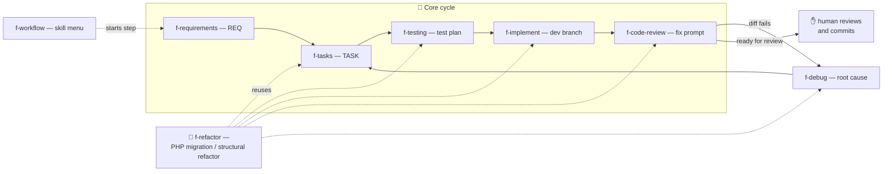

# agentic coding flow

[](#-skills)
[](#-quality)
[](#-install)

> A collection of reusable coding-agent skills that turn an ad-hoc chat into a disciplined
> feature cycle: requirements → tasks → tests → implementation → review, with debugging,
> docs, and refactor lanes around it.

The skills are plain Markdown instruction sets. They run in any agent harness that reads
`SKILL.md` files — OpenCode or a Claude-compatible setup.

> **Languages:** skill instructions are English. Human-facing documents that the skills
> generate in a target repository (README, architecture, decisions, feature summaries)
> are German.

---

## ⚡ Quick start

```bash
# 1. Install: symlink, never copy — the repo is the only source of truth
mkdir -p ~/.config/opencode/skills
ln -s ~/dev/acf/skills/f-* ~/.config/opencode/skills/

# …or project-local, inside the repository you want to use them in
mkdir -p .opencode/skills
ln -s ~/dev/acf/skills/f-* .opencode/skills/

# 2. Verify
ls -l ~/.config/opencode/skills   # every entry should point into this repo
```

Then let the agent drive. Either ask for the menu:

```text
skill menu
```

or jump straight into the cycle:

```text
Please use the f-requirements skill to turn the following into a structured
requirement document with strict, checkable acceptance criteria.

<Paste your ticket, free-text description, or notes here>
```

---

## 🧭 The cycle



- **Sidecars** (not steps of the cycle): `f-docs` for project documentation,
  `f-feature-summary` for product-owner feature overviews.
- **Debugging** (`f-debug`) is the side branch when something fails — findings feed
  back into the normal steps.
- **Refactoring** (`f-refactor`) is a separate workflow with its own phase menu. It
  reuses `f-tasks`, `f-testing`, `f-implement`, `f-code-review`, `f-debug`, and
  `f-docs`, and hands each step's code change to `f-implement`.
- `f-workflow` is the entry point with the menu and ready-to-paste prompts for
  every step.

---

## 📦 Skills

| Skill | Role | Writes to |
|-------|------|-----------|
| `f-requirements` | Turn free text, tickets, or notes into requirement documents with strict, checkable acceptance criteria (Given/When/Then + Check + Must-not). | `docs/requirements/` |
| `f-tasks` | Break requirements, review findings, or refactor plans into agent-sized tasks with complexity, priority, dependencies, and parallel groups. | `docs/tasks/` |
| `f-testing` | Derive test plans from the Check statements of acceptance criteria, or verify existing coverage. Characterization tests lock current behavior. | `docs/tests/` |
| `f-implement` | Implement exactly one task on a dev branch (TDD or direct mode). No commit, no push. | `docs/implement/` |
| `f-code-review` | Review a diff against the acceptance criteria plus security, performance, and side effects; deliver a ready-to-use fix prompt. | `docs/reviews/` |
| `f-debug` | Structured, evidence-based debugging: reproduce → isolate root cause → minimal fix proposal. Does not implement the fix. | `docs/debug/` |
| `f-docs` | Create or refresh README, architecture, conventions, and decisions from repository analysis. Writes `AGENTS.md` only when none exists and you agree. | README, `docs/architecture.md`, `docs/conventions/`, `docs/decisions/` |
| `f-feature-summary` | Turn implemented business logic into scannable feature documents (individual units plus overall overview). | `docs/features/` |
| `f-refactor` | Own phase menu for behavior-preserving PHP migrations (primary) or structural refactors — status lives in `docs/refactor/`. | `docs/refactor/` |
| `f-workflow` | Ordered menu of everything above with copy-paste prompt templates. Pure navigation. | — |

Each skill follows one shape:

```text
skills/<name>/
  SKILL.md        # YAML frontmatter (name, description) + behavior
  templates/      # artifacts written into the target repo
  references/     # detail knowledge, loaded on demand
  CHANGELOG.md
```

---

## 🧠 AGENTS.md & project memory templates

The repository root carries four copy-templates for target projects:

| File | Purpose |
|------|---------|
| `AGENTS.md` | Hard rules: conventions, boundaries, subagent delegation with model/reasoning tiers, and the memory contract. |
| `MEMORY.md` | Stable, verified facts. Max ~50, one dated bullet each. |
| `LEARNINGS.md` | New, unconfirmed observations (max ~10); get promoted to `MEMORY.md`/`ERRORS.md` or removed. |
| `ERRORS.md` | Recurring failures with symptom, cause, fix, and first/last seen dates. |

How it plays out in a target project:

- The agent **creates** a missing memory file the moment it has the first real entry —
  no manual copy into new repos is strictly required.
- Facts enter `MEMORY.md` only after verification (command run, test passed, or
  authoritative file read); the date is the verification date.
- **Code, README, and docs always outlast memory.** On conflict, the agent verifies
  and corrects the memory entry instead of following it.
- `MEMORY.md` and `ERRORS.md` stay in version control; agents add `LEARNINGS.md` to
  the project's `.gitignore`.
- When a target project has no `AGENTS.md` and you agree, `f-docs` writes one as
  a byte-exact copy of `skills/f-docs/templates/agents.md.tmpl`.

---

## 🗂 Repo layout

```text
acf/
  AGENTS.md           # template master — the active ruleset for target projects
  MEMORY.md / LEARNINGS.md / ERRORS.md   # memory template set (see above)
  README.md
  skills/
    f-*/
      SKILL.md        # frontmatter (name, description) + behavior
      templates/      # artifacts written into the target repo
      references/     # detail knowledge, loaded on demand
      CHANGELOG.md
  docs/               # internal artifacts (e.g. review reports), untracked by design
```

Every artifact a skill produces lands under `docs/` in the *target* repository
(`requirements/`, `tasks/`, `tests/`, `implement/`, `reviews/`, `debug/`,
`features/`, `refactor/`, `conventions/`, `decisions/`) — never in this one.
`skills/<name>/templates/` is the single source of truth for those artifacts.

---

## ✅ Quality

- **Markdown only.** No runtime, no build, no toolchain — nothing to install or update.
- **Skill contract:** every skill ships `SKILL.md` (YAML frontmatter: `name`,
  `description`) and a `CHANGELOG.md`; templates ship only what the skill actually owns.
- **Discipline by design:** skills never commit, never push, never touch databases or
  remotes; implementation and review stay in uncommitted working trees, and a human
  merges after review.
- **Verification is manual:** read the affected `SKILL.md`, then run the skill against
  a scratch repository. After editing the root `AGENTS.md`, mirror the change into
  `skills/f-docs/templates/agents.md.tmpl` and re-check with `cmp` (byte-identical).

## 🎨 Conventions in 30 seconds

- The `f-` prefix marks a skill of this collection — names are stable, installs depend on them.
- Skills produce documents; code changes flow exclusively through `f-implement`,
  inside one task's uncommitted dev branch.
- Each rule has one home: hard boundaries live in `AGENTS.md`, workflow phases in the skill.

## 🔗 Further reading

- [AGENTS.md](AGENTS.md) — the template master, including the exact memory format
- [f-refactor workflow](skills/f-refactor/references/workflow.md) — phases, artifacts, status handoffs
- [f-refactor toolchain](skills/f-refactor/references/toolchain.md) — isolated PHP tooling, outside the application
