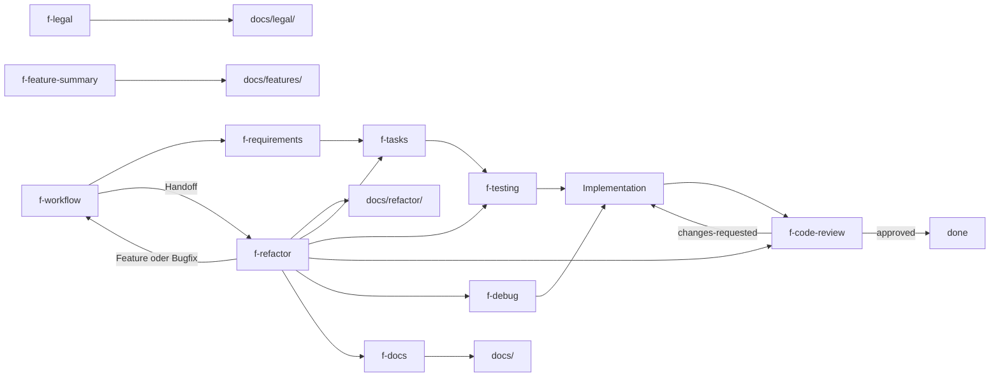

# Architektur

## Überblick

Das Repository enthält agentische Coding-Skills für OpenCode / Claude-kompatible Harnesses. Es gibt keinen ausführbaren Code: Jeder Skill ist eine Markdown-Anweisung, die ein Agent lädt und die ihn durch einen definierten Arbeitsschritt führt. Ergebnisse sind strukturierte Dokumente im Zielrepo unter `docs/`.

## Komponenten

- **`skills/f-requirements`:** Freitext oder Tickets → Requirement-Dokumente mit prüfbaren Acceptance Criteria (`docs/requirements/`).
- **`skills/f-tasks`:** Requirements, Ad-hoc-Arbeit oder Review-Findings → agentengerechte Tasks mit Priorität, Komplexität und Abhängigkeiten (`docs/tasks/`).
- **`skills/f-testing`:** Checks aus Acceptance Criteria → Testplan oder Coverage-Report (`docs/tests/`).
- **`skills/f-code-review`:** Diff gegen Acceptance Criteria prüfen, Sicherheits-/Performance-/Side-Effect-Checks, Fix-Prompt (`docs/reviews/`).
- **`skills/f-debug`:** Strukturierte Fehlersuche (Repro → Root Cause → Fix-Vorschlag) ohne Codeänderung (`docs/debug/`). Auch ein aus einem Review entstandener Bericht liegt dort; das Review verlinkt ihn.
- **`skills/f-docs`:** Repository analysieren und AGENTS.md, README, Architektur, Conventions, Decisions erzeugen.
- **`skills/f-legal`:** Juristische Quellen (DE/EU) → regulatorische Dokumente in `docs/legal/`.
- **`skills/f-feature-summary`:** Implementierte Fachlogik → übersichtliche Feature-Dokumente für Product Owner (`docs/features/`).
- **`skills/f-refactor`:** Eigener Ablauf neben `f-workflow` für verhaltensbewahrende PHP-Migration (vorrangig) oder Strukturänderung. Phasenmenü und Status liegen unter `docs/refactor/`. Aufgaben, Tests, Review, Fehlersuche und ADRs bleiben bei den bestehenden Skills. `done` setzt dieser Skill nicht. Produktion ist für den Agenten gesperrt. Der lesbare Ablauf steht in [workflow.md](../skills/f-refactor/references/workflow.md), die Werkzeuge in [toolchain.md](../skills/f-refactor/references/toolchain.md).
- **`skills/f-workflow`:** Menü und Prompt-Templates für den Feature-Ablauf. An `f-refactor` wird nur übergeben.

Jeder Skill folgt dem Aufbau `SKILL.md` (Frontmatter + Ablauf), optional `templates/`, `references/` und `CHANGELOG.md`.

## Datenfluss

1. Der Harness lädt `SKILL.md` anhand von `name` und `description` im Frontmatter.
2. Der Skill nimmt Nutzereingaben oder vorhandene Dokumente entgegen und liest bei Bedarf seine Templates und Referenzen.
3. Der Agent schreibt die Ergebnisse in das Zielrepo unter `docs/<bereich>/` und aktualisiert die jeweilige Index-Datei nach `skills/f-docs/references/directory-index.md`.
4. `f-workflow` verweist nur auf die Skills und deren Prompt-Templates; es erzeugt keine Dokumente.
5. Statusübergaben laufen über die Dokumente: Tasks werden von Implementierungsagenten auf `ready-for-review` gesetzt, `f-code-review` setzt `done` oder `changes-requested`. `blocked` setzen nur der User oder der implementierende Agent; `f-code-review` und `f-debug` empfehlen diesen Status höchstens.
6. `f-refactor` ist ein eigener Ablauf neben `f-workflow`. Es schreibt die Dokumente unter `docs/refactor/` und übergibt an `f-tasks`, `f-testing`, `f-code-review`, `f-debug` und `f-docs`. Feature- und Bugfix-Arbeit geht zurück an `f-workflow`. `f-workflow` führt keine Phase von `f-refactor` aus.

## Externe Abhängigkeiten

- OpenCode oder ein Claude-kompatibler Agent als Laufzeitumgebung.
- Installation über Symlinks von `skills/f-*` in `~/.config/opencode/skills/` oder projektlokal nach `.opencode/skills/` bzw. `.agents/skills/`.
- Sonst keine externen Dienste, Datenbanken oder Bibliotheken. Bei einer PHP-Migration liest `f-refactor` die unterstützten Versionen von php.net; Patchstände stehen nicht im Skill.

## Grenzen

- Das Repository implementiert keine Fachlogik und enthält keine Anwendung.
- Skills führen keine Codeänderungen an der zu prüfenden Änderung aus, außer wenn der Ablauf es ausdrücklich vorsieht (Implementierung ist kein Skill).
- `f-docs` erzeugt und pflegt `docs/legal/` nicht; dieses Verzeichnis gehört ausschließlich `f-legal`.
- `docs/refactor/` gehört `f-refactor`. Andere Skills schreiben dort nur die in `f-tasks` und `f-code-review` beschriebenen Status- und Task-Verweise.
- Migration und Refactor sind kein Schritt von `f-workflow`. Der Feature-Ablauf übergibt nur.
- Die Templates in `skills/*/templates/` sind Quelle, nicht generiertes Ergebnis.
