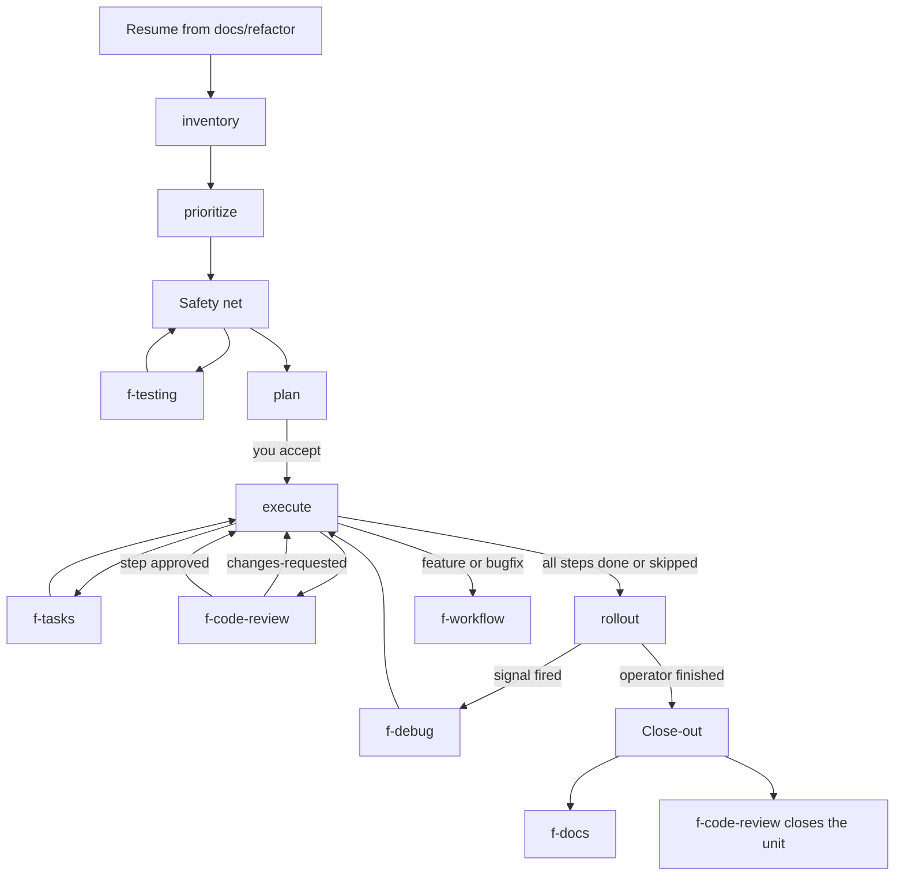

# Refactor workflow

Human-readable map of `f-refactor`. It is a separate workflow from `f-workflow`. One phase runs per session. Exit criteria and the prompts that get emitted live in `phases.md`. Tools live in `toolchain.md`. Licenses live in `tool-licenses.md`.

The agent writes under `docs/refactor/` in the target repository. It does not set a unit or a step to `done`.

## Types

Set **Type** on the plan before any step runs. If the request can be read either way, ask. Do not start.

| Type | What changes | What does not | Done when |
|------|----------------|---------------|-----------|
| `migration` (primary) | PHP, the framework, or dependencies, plus fixes that upgrade forces | Redesign, renames, new behavior, drive-by cleanup | The app runs on the target from php.net, the old production runtime is gone, and the close-out evidence holds |
| `refactor` | Structure at the current runtime | A version or framework bump, new behavior | The stated structure is in place and behavior is unchanged |

Work that belongs to the other type becomes a new `draft` unit. A bug is recorded on the plan and the step. It is not fixed here. A feature or a bugfix goes to `f-workflow`.

## Where the files go

```text
docs/refactor/index.md                          # one row per unit
docs/refactor/REF-001-<slug>/
  index.md                                      # templates/unit-index.md
  plan.md                                       # templates/plan.md
  inventory.md                                  # templates/inventory.md
  codebase-map.md                               # templates/codebase-map.md
  safety-net.md                                 # templates/safety-net.md
  rollout.md                                    # templates/rollout.md
  close-out.md                                  # templates/close-out.md
  open-questions.md                             # templates/open-questions.md
  decisions.md                                  # templates/decisions.md
  handoff.md                                    # templates/handoff.md
  steps/index.md                                # templates/steps-index.md
  steps/S01-<slug>.md                           # templates/step.md
```

Inventory creates the directory, the plan stub, the map, the questions log, the decision log, the handoff, and both indexes. Safety net, rollout, close-out, and `steps/` appear when that phase first runs. IDs are three digits (`REF-001`). `REF-001` does not match `REF-0010`.

## Phases

| Phase | What this phase produces | Template |
|-------|--------------------------|----------|
| `inventory` | Runtime, extensions, cron/CLI/workers, environment parity, effort | `inventory.md`, and a stub `plan.md` |
| `prioritize` | Priority, cross-repo dependencies, which units wait | `plan.md` |
| `safety-net` | Seams and golden-master rules. `f-testing` writes the test plan | `safety-net.md` |
| `plan` | Scope, non-goals, steps, team, rollback class, done criteria. Stays `draft` until you accept it | `plan.md` |
| `execute` | Exactly one step, then a review | `steps/Snn-<slug>.md` |
| `rollout` | Canary, approvals, signals. The operator deploys | `rollout.md` |
| `close-out` | Evidence against the done criteria, then a closing review | `close-out.md` |

Every stop also appends `handoff.md`. A phase advances only after its exit criteria in `phases.md` pass. Do not skip a phase.

## Status

Three fields. Phase and unit status on the plan header are copied to `docs/refactor/index.md`. That index is the progress view across units. Step status in the plan's step table is the source of truth for steps.

**Phase:** `inventory`, `prioritize`, `safety-net`, `plan`, `execute`, `rollout`, `close-out`. `f-refactor` advances it.

**Unit status:**

| Status | Who sets it | Meaning |
|--------|-------------|---------|
| `draft` | f-refactor on creation | Plan not accepted |
| `active` | f-refactor after you accept the plan | Execution may proceed |
| `deferred` | You, or f-refactor when this unit is not starting | Visible, not in progress |
| `blocked` | You, or the execute phase | Waiting on a decision or dependency |
| `done` | f-code-review when you asked to close the unit, or you | Every step is `done` or `skipped` and the done criteria hold |

Earlier phases may recommend `blocked`. They do not set it.

**Step status:**

| Status | Who sets it |
|--------|-------------|
| `todo` | f-refactor when the step is written |
| `in-progress` | Execute phase |
| `ready-for-review` | Execute phase, after verification |
| `changes-requested` | f-code-review |
| `done` | f-code-review on APPROVED, or you |
| `blocked` | You, or the execute phase |
| `skipped` | f-refactor or you, with evidence in the plan |

**Effort** on the plan and the index is `S`, `M`, `L`, or `XL`. It is a rough size, not a calendar estimate. `XL` means split the unit.

## Resume

A new session does not use chat history.

1. Read `docs/refactor/index.md` and pick the unit (ask if several are open).
2. Read that unit's `plan.md`, the newest `handoff.md` entry, and open questions.
3. Read `codebase-map.md` before scanning. Do not reread a module the map marks as mapped, and do not read the repository end to end.
4. If the index and the plan header disagree, repair the index from the plan. If a step and its task disagree, the step row wins, except a `done` without an APPROVED review goes back to `ready-for-review`.
5. Continue the current phase. On the way out, append a handoff: phase, branch, working tree, next action, blockers.

## Handoffs

`f-refactor` does not do the other skill's job. It writes its own documents and emits a prompt.

| When | Skill | What it owns |
|------|-------|----------------|
| A `todo` step has no task | `f-tasks` | One task per step, same type and order. No bugfix tasks |
| Seams need tests | `f-testing` | The characterization or golden-master test plan |
| A step is ready, or the unit should close | `f-code-review` | Behavior-preservation check. Sets `done` or `changes-requested` |
| A step or a rollout signal breaks | `f-debug` | Root cause and a fix proposal inside the same type |
| A boundary should be an ADR | `f-docs` | `docs/decisions/` in the target repo. Link it from `decisions.md` |
| The work is a feature or a bugfix | `f-workflow` | The normal feature cycle |

## Approval

Production access is off-limits for the agent: no production shell, database, logs, or deploy.

A human must approve before the agent runs a database migration or backfill, opens staging, changes dependency versions, deletes code, or deploys. The operator performs the action. The handoff records who approved.

No production or customer data in tests, golden files, or docs. A hardcoded secret is recorded as a file and line, never as the value, and the rotation goes to `f-workflow`.

## Flow


